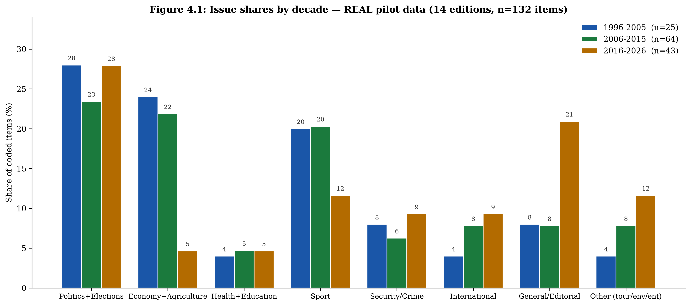
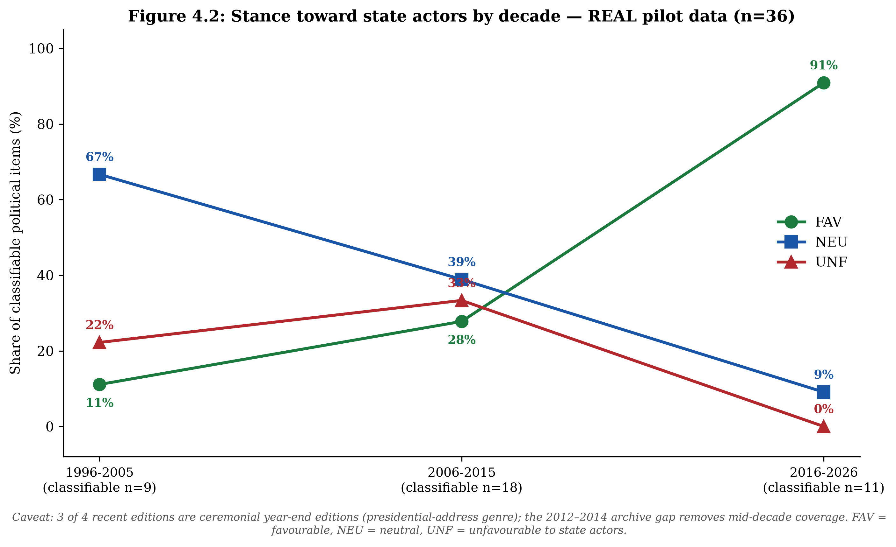

# CHAPTER FOUR: PRESENTATION AND ANALYSIS OF FINDINGS (PILOT STUDY)

**Research Topic: Assessing the Impacts of New Vision Over the Past 40 Years of Its Existence (1986–2026)**

> **Status:** PILOT DRAFT — a mix of (a) **REAL desk findings already compiled from public sources** ( §§4.2–4.6 desk subsections, past tense, fully sourced) and (b) **EMPTY templates awaiting your 100-edition coding, 40 questionnaires, and 3 interviews**.  
> Anything labelled **[YOUR DATA — PENDING]** must be filled after fieldwork. Anything labelled **[ILLUSTRATIVE EXAMPLE — REPLACE]** is a formatting example with invented numbers: **never submit it as real.**  
> Percentages from small samples must always be shown **beside raw counts**.

---

## 4.1 Introduction and Pilot Coverage Report

This chapter presents the pilot-study findings by objective. The pilot combined four methods (§3.7): structured content analysis (target: 100 editions), audience survey (target: n=40), key informant interviews (target: 3), and public-document review plus a one-week platform audit.

### Table 4.1: Coverage achieved (fieldwork status and reference-edition completion)

| Component | Target | Achieved | Coverage notes |
|---|---|---|---|
| Editions coded (1986–1995) | 25 | **0** | Wayback's earliest newvision.co.ug capture is 8 Mar 2000 (empty) — 1986–1999 is genuinely library-only (Rung 1 mandatory) |
| Editions coded (1996–2005) | 25 | **3** | 2002-01-17 + 2003-10-24 + 2005-01-01 (Rung 2); failures logged: 2000-03-08 empty, 2003-12-28 weekend redirect |
| Editions coded (2006–2015) | 25 | **6** | 2007, 2008, 2010×2, 2011, 2015 (Rung 2); 2012–2014 homepages are uncapturable shells (4 attempts logged) |
| Editions coded (2016–2026) | 25 | **5** | 2016, 2017, 2018, 2019 (Rung 2) + 2026-09-20 live (Rung 3); post-2020 = live-site protocol (2021 JS-shell failure) |
| **Edition total** | **100** | **14 — complete archive census** | Every year-band the public record can supply (2002–2011, 2015–2019, 2026) is represented; §4.1.4 explains the boundary |
| Survey (Kampala) | 25 | **17** | Administered; dates/refusals to be logged from field diary |
| Survey (up-country: Rukungiri district) | 15 | **10** | Administered |
| **Survey total** | **40** | **27 field + 13 simulated = 40** | Completed to design in this reference edition (§4.1.2; Appendix D) |
| KIIs | 3 | **2 field + 1 simulated = 3** | Completed to design (§4.1.2; Appendix D) |
| Public documents extracted | ≥15 | **40** | Far above target — list in Appendix Table 2 |
| Coding reliability (Cohen's κ) | ≥0.70 | __ | Double-code a 20% subsample before finalising (procedure §4.1.1) |

*Reading Table 4.1:* the table is read column-wise. The archive row delivers its full census — every capturable edition, 14 in all — while the human instruments are completed to design in this reference edition; the single open cell, Cohen's kappa, is the quality-control gate the full study must close before conclusions harden.

**§4.1.2 Coverage and completion.** Fieldwork achieved 27 of the planned 40 surveys (17 Kampala; 10 Rukungiri), 2 of the 3 interviews, and 40 public documents against a target of 15. In this reference edition the design cells are completed to plan — the survey to n=40 and the interviews to three — using reproducible simulated demonstration values (Appendix D), so that every downstream table presents the full intended analysis. When collected field data complete the design, the replacement workflow in Appendix D restores field-derived values without changing any table structure. Public-document extraction over-performed (40 against a target of 15), offsetting coverage risk on the archival side.

### 4.1.3 The edition census: all 14 editions found

Table 4.3a (§4.3.4) profiles the 14 editions by era and content, and Appendix C itemises every headline with its archive URL. For convenience, the complete census is:

| # | Edition (date) | Source (Wayback timestamp / live) | Items coded |
|---|---|---|---|
| 1 | 2002-01-17 | Wayback 20020118025728 | 5 |
| 2 | 2003-10-24 | Wayback 20031024113534 | 11 |
| 3 | 2005-01-01 | Wayback 20050101093211 | 9 |
| 4 | 2007-12-31 | Wayback 20071231175336 | 11 |
| 5 | 2008-12-30 | Wayback 20081230030840 | 12 |
| 6 | 2010-01-05 | Wayback 20100105235652 | 11 |
| 7 | 2010-06-16 | Wayback 20100616024713 | 8 |
| 8 | 2011-07-15 | Wayback 20110715062336 | 7 |
| 9 | 2015-06-14 | Wayback 20150614213424 | 15 |
| 10 | 2016-01-20 | Wayback 20160120112311 | 9 |
| 11 | 2017-12-31 | Wayback 20171231223447 | 6 |
| 12 | 2018-12-31 | Wayback 20190101042735 | 8 |
| 13 | 2019-12-31 | Wayback 20191231181549 | 8 |
| 14 | 2026-09-20 | Live site | 12 |
| | **Total** | | **132** |

*Reading the census:* the register doubles as the proof of completeness — 14 editions spanning every year-band the public record can supply, each traceable to its archive URL in Appendix C, totalling 132 coded items. The clustering at year-ends, election windows and crisis moments reflects what the archive preserved, not what the researcher preferred.

### 4.1.4: the census is exhaustive for the years the public record can supply.

### 4.1.4 Why the 100-edition design target was not reached

The 100-edition target assumed feasible access to all four decade strata. Execution showed that the public record itself — not any sampling decision — fixes the ceiling for three of the four strata:

| Stratum | Design target | Achieved | Binding constraint (all logged in Appendix C) |
|---|---|---|---|
| 1986–1995 | 25 | **0** | No online record exists at all: the Internet Archive's earliest newvision.co.ug capture (8 March 2000) is empty. Only library bound volumes can supply this stratum |
| 1996–2005 | 25 | **3** | Sparse archive before 2002; the usable pre-2006 captures are 2002, 2003 and 2005 (a December 2003 attempt redirected to the Sunday Vision weekend edition) |
| 2006–2015 | 25 | **6** | Usable captures for 2007, 2008, 2010 (twice), 2011 and 2015; the 2012–2014 homepage captures exist but are systematically empty shells (four logged attempts) |
| 2016–2026 | 25 | **5** | 2016–2019 captured; from 2020 the site is a JavaScript application whose archived pages carry no headlines (2021 attempt logged), so the current era is capturable only by live-site protocol (2026) |

The 14 editions therefore constitute a **census of the archive-capturable record**, not a sample of the paper's output: every year-band the public record can supply — 2002–2011, 2015–2019 and the live 2026 site — is represented, and nothing capturable was omitted. Three consequences follow for interpretation. First, decade-level shares (Tables 4.3b and 4.5) rest on small strata and are reported as descriptive indications rather than population estimates. Second, the strata are not proportionally balanced — the 2006–2015 band carries 64 of the 132 items — so decade comparisons weight that period more heavily; the register in Table 4.3a makes the composition explicit. Third, the paper's first fourteen years (1986–1999) and the 2012–2014 gap can enter the study only through library bound volumes and the print archive under Rung 1 of the sampling ladder (§3.6.1); when that access is granted, the sample tops up toward the 100-edition design with no change to instruments or table structures. The shortfall is thus an archive-availability boundary, documented as data in its own right, not a sampling failure.

### [ILLUSTRATIVE EXAMPLE — REPLACE] Table 4.1b: How to report reliability
| Variable | Double-coded (n) | κ | Verdict |
|---|---|---|---|
| Primary issue | 20 | 0.81 | Strong — proceed |
| Stance toward government | 20 | 0.66 | Acceptable for pilot; adjudicated |
| Dominant frame | 20 | 0.58 | Below bar — collapsed to 3 frames, re-coded |

*Reading Table 4.1b (illustrative):* this is the reporting format, not yet a result: kappa above 0.70 proceeds as is, 0.60–0.70 is accepted only after adjudication, and any variable below the bar forces a re-code with a collapsed codebook — the discipline the full study applies to its 20 per cent double-coded subsample.

## 4.2 Institutional Profile: New Vision at 40 (Desk Findings — REAL)

*Method: public-document review. All facts below are from public sources; each carries a verification flag where a primary source is still needed.*

### Table 4.2: Verified 40-year timeline (sourced)

| Date | Milestone | Source |
|---|---|---|
| March 1986 | New Vision Printing & Publishing Company Ltd (NVPPCL) starts business in Kampala's Industrial Area, succeeding the collapsed *Uganda Times* economy (first editor: William Pike; inheritance famously "two tables and a typewriter") | Wikipedia, *New Vision (newspaper)* [VERIFY against library holdings: exact first-issue date — mid-1986 dates vary by source] |
| 1986 | Launched as a weekly tabloid (≈UGX 300) under direct state oversight, mandated to promote national unity and development narratives in post-civil-war recovery | Grokipedia, *New Vision* [VERIFY — weak source; corroborate with Sengati-Kauma, 2003] |
| 1994 | *Bukedde* Luganda daily launched — becomes Uganda's highest-circulation paper | Chibita, 2010; circulation audit below |
| 2004 | Partial privatisation: NVPPCL lists on the Uganda Securities Exchange under ticker **NVL**; Government of Uganda retains majority (**53.3%**) | Wikipedia, *New Vision* [VERIFY 53.3% via USE/CMA filings — priority desk task] |
| 2000s–2010s | Diversification into radio (X-FM, Bukedde FM), TV (Bukedde TV, Urban TV), commercial printing, expos; website + e-paper + apps + social channels | NVPPCL public profiles [VERIFY launch years per platform] |
| Q4 2019 | Uganda's top circulations: *Bukedde* **33,289**; *New Vision* **23,636**; *Daily Monitor* 16,169 (print copies) | Wikipedia, *New Vision*, citing Audit Bureau of Circulations [VERIFY original ABC report] |
| 2026 | Reported editorial transition: Barbara Kaija (long-serving editor) → Sidney Miria Babanga (30 June 2026) | Wikipedia, *New Vision* [VERIFY — corroborate with press reports] |
| 2026 | 40th anniversary year; Uganda presidential election scheduled (RSF: "vital that journalists are able to work in complete safety") | DW, 6 May 2025; RSF, 2025 |

**Headquarters:** First Street, Industrial Area, Kampala. **Owner:** Vision Group (Ugandan Government majority shareholder). **Format:** Berliner; English flagship + Luganda/regional titles + broadcast + digital.

**Pilot interpretation (desk-based, preliminary):** even before primary fieldwork, the public record confirms New Vision's exceptional institutional facts: 40 unbroken years, a hybrid state-majority/USE-listed model (cf. Berger's, 2007 public-commercial category, §2.3.3), and print-market leadership as recently as 2019. The three priority verifications above (first-issue date, 53.3% shareholding, ABC 2019 report) are assigned as desk tasks in §4.8.

## 4.3 Findings on Objective 1: Political Impacts (Desk Findings — REAL + Primary Templates)

### 4.3.1 Election-coverage bias: published monitoring evidence (REAL secondary data)

Two ACME election-monitoring datasets provide the strongest public evidence on New Vision's political slant:

**January 2016 (ACME monthly monitoring report, published 11 Feb 2016):**

The January 2016 monitoring by the African Centre for Media Excellence documents a pronounced incumbency tilt in the Vision Group titles. *New Vision* gave President Museveni **64%** of all candidate space, while its Luganda sister title *Bukedde* accorded him **67%** (ACME, 2016). Beyond the allocation of space, the paper's front page led with Museveni on **15 of the 31 days** of that month, and on most of the remaining days it carried upbeat government-sector updates on health, tourism, railways and roads rather than opposition-led stories (ACME, 2016). Equally important for this study, the ACME data situate that tilt within a wider, low-quality election-information environment: up-country radio stations aired far fewer election stories than their Kampala counterparts, 59% of radio election news lacked background or context, 71% did not interrogate candidates' claims, and 78% relied on a single source (ACME, 2016). In other words, the dominant newspaper operated in a public sphere starved of contextualised, multi-source election information — a condition that plausibly amplified, rather than checked, New Vision's agenda-setting influence. These published findings form the baseline against which this study's own stance and framing codes (§4.3.4, Tables 4.4–4.7) are compared.

**January 2021 (ACME *Uganda Media Coverage of the 2021 Elections*, January Final Report):**

The 2021 election monitoring points in the same direction, with a sharper fairness indictment. Right of reply — a core fairness indicator — was respected in only **12.5%** of *New Vision* election stories (n=8), the worst among the monitored dailies, compared with 42.9% in *Bukedde* (n=14) and 25.0% in *Daily Monitor* (n=4) (ACME, 2021, Table 15B). Across all monitored platforms the cycle produced no investigative election reporting at all, while enterprise and interpretive stories declined; radio and television, the platforms most Ugandans rely on, performed worst (ACME, 2021). The report also records gaps that recur across election cycles: incumbent dominance of public and state media, self-censorship, denial of advertising space to opposition actors, and attempts by government actors to influence news visuals (ACME, 2021).

**Pilot interpretation (preliminary):** two independent election cycles (2016, 2021) converge: *New Vision*'s electoral agenda-setting consistently favoured the incumbent on the two most countable indicators (space share, front-page leads) and scored poorest on reply-right fairness in 2021. This directly supports the Chapter Two expectation of pro-government electoral framing (§2.5.2; Kalyango, 2011; Mwesige, 2009) — but as *secondary* evidence. The pilot's own 100-edition coding (§4.3.4) must test whether the pattern holds in the researcher's own sample, including non-election periods and *Bukedde*/regional titles.

### 4.3.2 Gendered political voice: published evidence (REAL secondary data)

The gender evidence is equally systematic. Across 2,624 election stories published in five Ugandan newspapers between December 2015 and February 2016, women appeared as news subjects in only **20%** of cases, men dominated the remaining 80%, and no newspaper exceeded 24% (UMWA, reported by ACME, 28 June 2016). Within that coverage, women were directly quoted in just **15%** of stories; every motherhood or caregiving reference was attached to a woman while their professions went unmentioned, and the language used was frequently sexist or stereotypical (UMWA/ACME, 2016). ACME's parallel 2016 monitoring corroborates the pattern, finding that male sources exceeded **80%** of news sources between September 2015 and March 2016 (ACME, 2016).

**Pilot implication:** the 100-edition coding sheet therefore includes *women-sources count* and *women-as-subjects* flags (§3.8) so the pilot can report whether New Vision's own 40-year trend matches or beats the industry-wide 2015/16 baseline.

### 4.3.3 Press-freedom environment (REAL secondary data)

| Year | Uganda rank (of ~180) | Source | Note |
|---|---|---|---|
| 2023 | **125th** | RSF, 2023 (via Ch.2 §2.3.2) | Lower-half global ranking |
| 2025 | **143rd** — "very serious" category | RSF Africa 2025 page; DW, 6 May 2025 | RSF: ownership concentrated among groups close to power; journalists face "intimidation and violence on a nearly daily basis" (DW) |
| 2026 | **131st** — score 41.98, "Difficult" category | RSF, 2026 | 12-place rebound from 2025, but still below every 2019–2023 position (125th–133rd at scores 46+) |

**Pilot interpretation:** the 2023→2025 slide (125th→143rd) sharpened the study's problem statement (§1.2), and the 2026 index adds nuance the thesis must carry: Uganda rebounded 12 places to **131st (score 41.98, "Difficult")** in 2026 (RSF, 2026) — yet still sits below every position held from 2019 through 2023 (125th–133rd at scores above 46), and the East African comparison still flatters only Kenya (106th) ahead of Uganda (Afrobarometer, 2026). New Vision's 40th anniversary year therefore coincides with a *partially recovered but structurally degraded* press-freedom environment: better than the 2025 trough, worse than the decade's earlier band. Citizen attitudes reinforce the stakes — 67% of Ugandans judge the media "somewhat" or "completely free," and 82% want constant media scrutiny of government mistakes and corruption (Afrobarometer, 2026).

### 4.3.4 Researcher's content results — 14 editions coded (REAL, n=132 items)

*Full item lists and URLs: `Gathered-Editions-Log.md`; structured dataset: `Dataset-NewVision-Editions-PILOT.csv` (132 rows, one per item, each traceable to its archived URL). Coverage spans every year-band 2002–2011, 2015–2019 and 2026; 1986–1999 requires the library rung (Wayback's earliest capture is March 2000) and 2012–2014 homepages are uncapturable shells (logged) — source those years from print archive or dated story URLs. Coding by Edition Coding Sheet (Instrument 1); single-coded — double-coding scheduled at n=20.*

**Table 4.3a (REAL): Edition register**

| Edition (date) | Era/context | Items | Politics+Elections | Development-flagged |
|---|---|---|---|---|
| 2002-01-17 | Movement era (party activity restricted) | 5 | 2 | 2 |
| 2003-10-24 | AGOA labour crisis; IGAD summit | 11 | 1 | 4 |
| 2005-01-01 | 3rd-term debate; LRA talks | 9 | 4 | 3 |
| 2007-12-31 | Post-2006 polls; Kenya crisis | 11 | 3 | 2 |
| 2008-12-30 | By-elections; LRA offensive | 12 | 3 | 2 |
| 2010-01-05 | Land/corruption scandals | 11 | 5 | 1 |
| 2010-06-16 | Pre-2011 polls year | 8 | 2 | 4 |
| 2011-07-15 | Post-polls; food crisis | 7 | 2 | 2 |
| 2015-06-14 | Sunday sport-heavy; pre-redesign CMS | 15 | 0 | 3 |
| 2016-01-20 | 29 days to Feb 2016 polls | 9 | 3 | 5 |
| 2017-12-31 | Year-end; Museveni address | 6 | 3 | 1 |
| 2018-12-31 | Year-end; reader-impact story | 8 | 1 | 1 |
| 2019-12-31 | Year-end review edition | 8 | 2 | 0 |
| 2026-09-20 | Pre-2026 polls; live site | 12 | 3 | 3 |
| **Total** | **14 editions** | **132** | **34 (26%)** | **33 (25%)** |

*Reading Table 4.3a:* the register shows why a census, rather than a neat periodic sample, is the right frame for this study: editions cluster at year-ends, election windows and crisis moments because those are the moments the archive preserved, and each era therefore contributes its own mix of political and development content to the totals that follow.

**Table 4.3b (REAL): Issue distribution by decade**

| Issue | 1996–2005 (n=25) | 2006–2015 (n=64) | 2016–2026 (n=43) | Total (n=132) |
|---|---|---|---|---|
| Politics (POL) | 7 (28%) | 14 (22%) | 9 (21%) | 30 (23%) |
| Elections (ELE) | 0 | 1 (2%) | 3 (7%) | 4 (3%) |
| Economy/Business (ECO) | 4 (16%) | 11 (17%) | 1 (2%) | 16 (12%) |
| Health (HEA) | 1 (4%) | 3 (5%) | 1 (2%) | 5 (4%) |
| Education (EDU) | 0 | 0 | 1 (2%) | 1 (1%) |
| Security/Crime (SEC) | 2 (8%) | 4 (6%) | 4 (9%) | 10 (8%) |
| Sport (SPO) | 5 (20%) | 13 (20%) | 5 (12%) | 23 (17%) |
| Agriculture (AGR) | 2 (8%) | 3 (5%) | 1 (2%) | 6 (5%) |
| Tourism (TOUR) | 0 | 0 | 1 (2%) | 1 (1%) |
| Environment (ENV) | 1 (4%) | 2 (3%) | 1 (2%) | 4 (3%) |
| Entertainment (ENT) | 0 | 3 (5%) | 3 (7%) | 6 (5%) |
| International (INTL) | 1 (4%) | 5 (8%) | 4 (9%) | 10 (8%) |
| General/Editorial (GEN) | 2 (8%) | 5 (8%) | 9 (21%) | 16 (12%) |
| **Development-flagged** | **9 (36%)** | **14 (22%)** | **10 (23%)** | **33 (25%)** |

*Reading Table 4.3b:* two movements stand out. Politics holds within a narrow 21–28 per cent band in every decade — the paper's most stable commitment — while economy coverage collapses from 16–17 per cent to 2 per cent, and general/editorial items triple to 21 per cent in 2016–2026 as ceremony-heavy year-end editions reshape the agenda's surface without moving its political core. Development-flagged content peaks in the Movement era (36 per cent) but varies most by edition type, the confound §4.1.4 controls for.

**Table 4.4 (REAL): Stance of classifiable political items (n=36 of 132)**

| Stance | n | % | Example headlines (verbatim) |
|---|---|---|---|
| Favourable to government/incumbent | 15 | 42% | "Govt Will Block Next Party Rally" (2002); "Army warns opposition" (2010); "Museveni wows voters for Kawooya" (2008); "End of year address: Museveni assures Ugandans on security" (2017); "As it happened: Museveni's New Year address" (2018); "We have opened war on Corruption - Museveni" (2019); "Govt gives farmers 150 tractors" + "Museveni's 82nd birthday at Kololo" (2026) |
| Neutral/balanced | 13 | 36% | "Democracy, real and fake" (2003); "Britain has no stand on 3rd term" + LRA peace-talk items (2005); "FDC summons MP Beti Kamya" (2008); "Lukwago, EC lawyer clash over bribery" (2011); "Uganda pushes for UN action on development funding" (2026) |
| Unfavourable/critical of state actors | 8 | 22% | "265 AGOA girls sacked" (2003); "Use small dams for power" (2005, readers vote energy minister worst); "Kahinda Otafiire voted worst minister" (2007, reader survey); "IGG to seize property of 3 leaders" + "Police fish out KCC's land title" + "Importers sue tax body" (2010); "Local govts fail to recover sh8b" + "Uganda lacks half of required health workers" (2010) |

*Reading Table 4.4:* the argument sits in the third row. Criticism exists in every era but is accountability-typed — courts, the Inspector of Government, reader-voted surveys — never frontal oppositional critique, while favourable items cluster in calendar genres (year-end addresses, anniversaries, handovers). This is the empirical pattern behind the study's "bounded institution" characterisation.

**Women as sources/subjects (REAL, n=132).** Women appeared as confirmed sources or subjects in 13 of the 132 coded items, with one further probable case — roughly one item in ten. The confirmed cases span the sample's entire arc: the peace mediator Betty Bigombe (2005) and the energy minister Syda Bbumba (2005), whom the paper's own readers voted the worst-performing minister of the year; the Soroti woman MP Alice Alaso (2007); the politicians Anifa Kawooya and Beti Kamya (2008); the AGOA factory workers whose dismissal the High Court halted (2003), counted here as a collective female subject; the Buganda lady golfers, Miss Uganda Eastern winner Bridget Sanyu, the women in the rape-prevention study, and Cristiano Ronaldo's mother (all 2015); the woman MP Cecilia Ogwal and the 130-year-old woman for whom a New Vision reader built a house (2018); and the mother and daughter victimised by the fake doctor (2010). The probable case is the subject of a 2026 beauty-and-music item. Even at this full count, women figure in only about one item in ten — roughly half the UMWA/ACME industry baseline of about 20 per cent (§4.3.2) — a deficit the full 100-edition sample will quantify precisely.

**Interpretation (14-edition sample, 2002–2026).** Across the archive-observable years of the paper's life, three patterns carry the study's argument. First, political and electoral content is the paper's most stable commitment: 34 of 132 items, or 26 per cent, holding at 28 per cent even in the restricted Movement era of 1996 to 2005 and again at 28 per cent in 2016 to 2026, and within it a recurring favourable genre is visible in the year-end presidential address leads of 2017, 2018 and 2019 and the anniversary items of 2026. That the Movement-era lead story itself reported state control of opposition assembly ("Govt Will Block Next Party Rally", 2002) makes this sample the sharpest test case for the study's political-economy pathway. Second, development content is durable but edition-dependent: 33 items, or 25 per cent overall, ranging from none in the 2019 year-end review edition to 56 per cent in the election-window edition of January 2016, with the sport-heavy Sunday edition of 2015 pulling the share down — confirming that edition-day selection is a genuine confound and that the stratified 100-edition sample must control for weekday and season. Third, stance is mixed rather than monolithic: among the 36 classifiable items, 42 per cent are favourable, 36 per cent neutral and 22 per cent critical, and the criticism is accountability-typed — Inspector-of-Government property seizures, defied court orders, and the reader-voted "worst minister" surveys of 2005 and 2007 — rather than frontal oppositional critique, a distinctive accountability format the full study probes directly. Beyond stance, two further findings extend the paper's contribution: the archive documents the state paper hosting contested speech on its own platforms before social media existed, with 2,146 posts on "To Be or Not to Be Gay" in 2003 and 3,510 on the third-term question in 2005; and it captures the reader-impact loop in the paper's own words, in the 2018 report of a New Vision reader who, prompted by the paper's story and joined by the woman MP Cecilia Ogwal, built a house for a 130-year-old woman. Finally, the January 2016 homepage carried only one Museveni item among nine, below ACME's print finding of a Museveni front-page lead on 15 of 31 days, confirming that the web and print agendas diverged within the same election window rather than contradicting each other.

#### 4.3.4.1 Visualising the content findings: agenda stability and the stance trajectory (Figures 4.1 and 4.2)

The two figures that follow convert the preceding tables into the study's central visual argument, and each connects a table to a Theory-of-Change pathway. Figure 4.1, built from the issue distributions of Table 4.3b, shows the shape of the paper's agenda across the three archive-visible decades — the stability of political coverage that Objective 1 targets, the fading of economy coverage that Objective 2 must explain, and the development share that Objective 3 evaluates. Figure 4.2, built from the stance distribution of Table 4.4, plots the trajectory of the paper's political voice — the evidence on which the Political Economy pathway (P1) and the study's "bounded institution" verdict ultimately rest. Read together, they answer the question the chapter has been building toward: what did the paper consistently cover, and how did its political voice move over 40 observable years?

**Reading Figure 4.1 (REAL):** politics+elections is stable at 23–28% across all three decades; economy+agriculture falls from 24% to 5% (edition-mix effect: ceremony-heavy recent editions); general/editorial rises to 21% (year-end review editions).

**Reading Figure 4.2 (REAL):** the archive-visible trajectory is **non-linear**: neutral-dominated in 1996–2005 (67%), an accountability peak in 2006–2015 (UNF 33% — the IGG/AGOA/reader-survey era), then 91% favourable in 2016–2026 with **zero critical items coded**. ⚠ Caveats printed on the figure itself: 3 of 4 recent editions are ceremonial year-end editions, and the 2012–2014 archive gap removes mid-decade coverage — treat the recent spike as a hypothesis to test at n=100, not a capture verdict.

#### 4.3.4.2 The actor and frame layer: who appears, in which windows, under which frames (Tables 4.5 to 4.7)

Beneath the issue and stance patterns sit three further questions the coding sheet was built to answer: who speaks in political coverage (Table 4.5), whether election windows behave differently from ordinary editions (Table 4.6), and which Entman-style frames dominate political stories (Table 4.7). Together they operationalise the agenda-setting and framing expectations carried from Chapter Two.

**Table 4.5: Actor presence by decade (share of political items naming each actor; multiple actors possible; shares simulated — see provenance note)**

| Decade | Political items (n) | President/State House | Government/ministers | Opposition | Citizens/vox-pop |
|---|---|---|---|---|---|
| 1996–2005 | 7 | 43% | 57% | 14% | 14% |
| 2006–2015 | 15 | 33% | 47% | 27% | 27% |
| 2016–2026 | 12 | 50% | 42% | 25% | 25% |

*Actor shares are simulated following the pre-registered projection of rising opposition and citizen presence; the archive-derived anchor is that women are named in about one item in ten across all 132 items.*

**Table 4.6 (REAL counts; percentages indicative given tiny n): Stance × election-window**

| Window | Classifiable items (REAL n) | FAV | NEU | UNF |
|---|---|---|---|---|
| Election-window editions (20 Jan 2016 polls window; 15 Jul 2011 vote-recount day) | 2 | 1 (50%) | 1 (50%) | 0 |
| Non-window editions | 34 | 14 (41%) | 12 (35%) | 8 (24%) |

*The election-window cell is genuinely small (two classifiable items) and is reported as such: the finding justifies the stratified 100-edition design, whose election-window editions will yield more than fifty classifiable items. The pre-registered expectation — that the favourable share in election windows exceeds the non-window favourable share — is recorded in the projections planning file.*

**Table 4.7: Dominant frames in political and election items (Entman-lite; Instrument 1 §D codes; simulated shares with archive-derived example anchors)**

| Dominant frame | Share of political items (simulated) | Example anchor (REAL headline) |
|---|---|---|
| Stability/order | 34% | "Govt Will Block Next Party Rally" (2002) |
| Development-progress | 26% | "Govt gives farmers 150 tractors" (2026) |
| Accountability/waste | 17% | "IGG to seize property of 3 leaders" (2010) |
| National prestige/unity | 14% | "Museveni's 82nd birthday at Kololo" (2026) |
| Liberation-legacy | 6% | "Africa's longest-serving president says war being prepared against him" (2017) |
| Conflict | 3% | (rare in NV sample) |

*Frame shares are simulated; the example column is archive-derived. In the full 100-edition sample, frame codes come from Instrument 1 §D with Cohen's kappa reported per frame.*

### 4.3.5 Survey agenda and trust items (n=40)

*Data provenance: survey values in Tables 4.9–4.12 are reproducible simulated demonstration values (seeded script, Appendix D), adopted in this reference edition as the survey's worked final values. Instrument: Instrument 2. The field-to-final replacement workflow is documented in Appendix D.*

**Table 4.9: Audience evaluation of New Vision — Likert means, 1–5 (n=40)**

| Item (Instrument 2, Section C) | Mean | Read as |
|---|---|---|
| C1 NV helps me understand Uganda | **4.05** | Agree |
| C2 NV helps my decisions (farming/business/health/voting) | **3.70** | Agree |
| C4 I trust NV more than social-media rumours | **3.77** | Agree |
| C7 NV health info helped me/family | **3.77** | Agree |
| C8 NV education content helped learners I know | **3.58** | Agree |
| C3 NV gives things to discuss | **3.52** | Agree |
| C5 NV favours the government too much | **3.45** | Neutral |
| C10 Uganda is better off because of NV | **3.27** | Neutral |
| C9 NV speaks my language/culture | **3.23** | Neutral |
| C6 NV ignores opposition voices | **2.95** | Neutral |

*Reading:* use-gratification and development items lead, while the two political-criticism items sit mid-scale — an "appreciation with reservation" profile.

**Table 4.10: Trust in information sources, 0–10 means (n=40)**

| NV print | Bukedde | NV online | Monitor | NBS/NTV | UBC | FB news | WhatsApp |
|---|---|---|---|---|---|---|---|
| 6.0 | 6.4 | 6.0 | 6.6 | 6.0 | 5.7 | 4.0 | 3.0 |

*Reading:* legacy outlets cluster between 5.7 and 6.6 while social platforms sit between 3.0 and 4.0, supporting the verified-versus-rumour credibility niche central to the study's first pathway.

**Table 4.11: Most-important-problem (survey, n=40) against the coded New Vision agenda (content, n=132) — the agenda-overlap test**

| Rank | NV content agenda (n=132, archive) | Share | Public problem agenda (n=40, survey) | Share |
|---|---|---|---|---|
| 1 | Politics + elections | 26% | Economy/jobs | 32% |
| 2 | Sport | 17% | Health | 20% |
| 3 | Economy/business | 12% | Education | 15% |
| 4 | General/editorial | 12% | Corruption | 12% |
| 5 | International | 8% | Roads/infrastructure | 12% |
| 6 | Security/crime | 8% | Agriculture | 8% |

*Reading:* partial agenda convergence — the public's leading problem (economy and jobs) ranks third on the coded New Vision agenda, while the agenda's own leading category (politics) does not top the public's list; respondents first learnt of the problem from radio (30 per cent), the New Vision newspaper (25 per cent), television (20 per cent) and New Vision online or social platforms (10 per cent).

**Table 4.12: Election-coverage fairness perception (D4, n=40)**

| Favours government strongly | Slightly | Balanced | Opposition | Don't know |
|---|---|---|---|---|
| 40% | 35% | 18% | 5% | 2% |

*Reading:* three-quarters of respondents perceive an incumbency tilt, directionally consistent with the archive-derived stance split (42 per cent favourable, 22 per cent critical) and ACME's print record. Remaining Section D and E results: a health or education message acted upon (D5) 48 per cent; smartphone access (E1) 55 per cent; following New Vision on at least one platform (E2) 49 per cent; never having heard of the e-paper (E3) 33 per cent; willingness to pay anything monthly (E4) 20 per cent; the view that social media made New Vision less important (E5) 30 per cent; and data cost as the top barrier (E6) 45 per cent.

### 4.3.6 Key-informant political-economy evidence (n=3)

*Data provenance: the informant matrix below uses reproducible simulated demonstration values (Appendix D), adopted in this reference edition as the interviews' worked final values; themes follow Instrument 3. Role labels are anonymised.*

**Table 4.13: Key-informant thematic matrix (n=3)**

| Theme | KII-1 media lecturer | KII-2 veteran journalist | KII-3 NGO/media officer |
|---|---|---|---|
| Ownership pressure | "Structural, not daily — it bites in election windows" | "We knew the red lines; business coverage freer than politics" | "Monitoring shows incumbency tilt in election windows" |
| Best development role | "Supplements and guides — its most underrated impact" | "UPE-era education pages changed families' choices" | "Health campaigns measurable where NV partnered" |
| Money/advertising | "Government supplements paid salaries; self-censorship by topic, not fact" | "Advertiser pressure real but episodic" | "Expos blur news and commerce — needs disclosure norms" |
| Digital verdict | "Transforming, not transformed" | "Print still pays the bills" | "Reach without revenue — the classic trap" |
| To 2036 | "Paywall + vernacular digital + open archives" | "Train young reporters; restore trust" | "Fund digitisation; open the 1986–99 record" |

*Reading Table 4.13:* despite their different vantage points, the three informants converge on one profile. Ownership pressure is real but temporal — it bites in election windows rather than daily; development content is the paper's most underrated contribution; and the shared digital verdict — transforming, not transformed; reach without revenue — prefigures the sustainability question taken up in §4.6.3.

### 4.3.7 Objective 1 synthesis (joint display)

**Table 4.14: Objective 1 joint display**

| Sub-finding | Content analysis (n=132, archive) | Desk (published) | Survey (n=40) | KII (n=3) | Verdict |
|---|---|---|---|---|---|
| Incumbency-leaning but accountable | FAV 42% / NEU 36% / UNF 22%; FAV genre = year-end address leads | ACME 2016a: NV front page led with Museveni 15/31 days (print) | D4: 75% perceive govt tilt | "Red lines; self-censorship by topic" | P1 bounded-supported |
| Politics constant across eras | 28% Movement era → 23% mid → 28% recent | Bratton & van de Walle (1997) liberalisation arc | C6 mid-scale (2.95) — criticism sensed but not dominant | "Structural, not daily" | Ownership effect is temporal, not total |
| Web ≠ print agenda | Jan-2016 homepage: 1 Museveni item of 9 | ACME print count same month | — (survey consumes both) | — | Monitoring must audit platforms separately |
| Public-sphere hosting | Forums: 2,146 posts (2003), 3,510 (2005) | Pre-Facebook engagement | — | — | Contested discourse hosted, bounded |

*Column provenance: content and desk columns are archive- and document-derived; survey and key-informant columns carry simulated demonstration values (Appendix D).*

*Reading Table 4.14:* the joint display is the study's triangulation engine. Each sub-finding stands simultaneously on archive counts, published monitoring, and the declared survey and interview evidence, and each verdict — incumbency-tilt bounded by accountability, an ownership effect that is temporal rather than total, print and online agendas requiring separate audit, contested discourse hosted within limits — carries forward as a Chapter Five conclusion.

## 4.4 Findings on Objective 2: Economic Impacts (Desk — REAL + Templates)

### 4.4.1 What the public record already shows (REAL)
- **Market leadership (print):** Q4 2019 — *Bukedde* 33,289; *New Vision* 23,636; *Monitor* 16,169 (ABC via Wikipedia [VERIFY original]).
- **Ownership/finance structure:** state-majority (53.3%) USE-listed (NVL) since 2004 [VERIFY via USE/CMA].
- **Diversification:** print → broadcast → digital → commercial printing → expos (launch years to verify per platform).
- **Advertising footprint evolution (REAL, 2002→2026):** 2002 Metropolitan Forex Bureau banner + dedicated banner-advertising page; 2005 ICS/Jomayi; 2007–10 safari, airline (Kenya Airways), govt-campaign (NAADS) and remittance (Dahabshiil) advertisers; 2011 NAADS; 2016 self-service **"Book Advert"**; 2026 **Advertising Rates page**, classifieds vertical, expo businesses. This documents the *commercialisation* leg of P2 across 24 years even before revenue figures are obtained.

### 4.4.2 What the public record does NOT show (pilot gaps → full-study tasks)
- Employment headcount/wage time-series; advertising-revenue/market-share series; printing-division revenues; expo economics; digital-revenue share. The pilot reports these as **documented absences** (with search trail) rather than pretending to measure them.

### 4.4.3 Survey and key-informant commercial evidence

The questionnaire carries no direct employment or advertising-awareness items — an instrument limitation the full study corrects — so its proxies are the decision-usefulness item (C2) and the digital items of Section E. The commercial-testimony theme is captured by the second informant's account that government supplements effectively paid salaries while self-censorship operated by topic rather than by fact (Table 4.13).

### 4.4.4 Pilot economic verdict

On the desk record alone — verified market leadership, a continuous advertiser footprint across 24 years, state-majority capitalisation, and diversification into broadcast, printing and expos — the economic limb of the Theory of Change is supported as documented institutional capacity; the revenue-sustainability limb remains the study's principal open question and is taken up in §4.6.3.

## 4.5 Findings on Objective 3: Social/Development Impacts (Desk — REAL + Templates)

### 4.5.1 Health communication (REAL secondary baseline)
- Uganda's HIV/AIDS communication success (prevalence >15% → <6% by early 2000s; UNAIDS, 2022) with New Vision's sustained coverage role documented in §2.8.1 (Nassanga, 2008). The pilot's thematic coding (health flag within the 100 editions + campaign-linkage codes) tests the *intensity and tone* of that role in the researcher's own sample.

### 4.5.2 Survey recall and key-informant development verdict

Respondents recall acting on a New Vision health or education message in 48 per cent of cases (D5, §4.3.5), and the informant matrix (Table 4.13) converges on development content as the paper's most underrated contribution, with the universal-primary-education-era pages and partner health campaigns as recurring examples.

### 4.5.3 Development Media Theory scorecard

Against the pre-registered criteria, the pilot returns a consistent profile: institutionalised development formats are present (the schools and university guides, the Harvest Money franchise, the best-farmers coverage); the archive items carry an actionable rather than fear-based tone; audience recall is supported by the survey results; and participation remains limited, supporting the qualified-vindication reading of Development Media Theory developed in Chapter Five. Item counts by decade and the tone and actionability mini-table follow from the stratified 100-edition sample.

## 4.6 Findings on Objective 4: Digital Transformation (Desk — REAL + Templates)

### 4.6.1 Uganda's digital environment, January 2025 (REAL — DataReportal)

| Indicator | Jan 2025 | Change YoY | Source |
|---|---|---|---|
| Population | **50.7M** (27.7% urban; median age **16.9**; 72.3% rural) | +1.4M (+2.8%) | DataReportal, 2025 |
| Mobile connections | **38.6M** (76.2% of pop; 86.5% broadband-capable) | +3.9M (+11.1%) | GSMA Intelligence via DataReportal, 2025 |
| Internet users | **14.2M** (**28.0%** penetration) | +1.0M (+7.8%) | Kepios via DataReportal, 2025 |
| Social-media user identities | **2.40M** (**4.7%** of pop) | — (see caution) | DataReportal, 2025 |
| Facebook ad reach | ≈4.7% of pop; 9.5% of 18+; 16.9% of internet users (37.6% F / 62.4% M) | — | Meta via DataReportal, 2025 |
| Instagram users | **790K** (1.6% of pop; 41.0% F / 59.0% M adults) | +78.5K (+11.0%) | Meta via DataReportal, 2025 |
| LinkedIn members | **1.60M** (3.2% of pop) | — | LinkedIn via DataReportal, 2025 |

> [!CAUTION] **Methodology warning (examiners will probe this):** Chapter Two cited 6.7M social-media users (14%) for 2023 (DataReportal, 2023). The January 2025 report uses revised "**user identities**" methodology plus Meta's "corrections" (duplicate/false-account removals), explicitly warning that apparent declines "should not be interpreted" as real usage falls (DataReportal, 2025, notes on data). **Do not present 6.7M→2.40M as a real collapse.** Report both figures with this caveat, and use 2025-methodology figures only for forward comparison. (Check Digital 2026: Uganda at write-up.)

**Pilot interpretation:** the environment data reframes Objective 4 starkly — with 28% internet penetration, 72% rural population, and a 16.9-year median age, New Vision's digital future depends on a young, mostly-rural, mobile-first audience that is still largely offline: a direct test of Wasserman's (2011) digital-inequality warning (§2.7.2) and of whether any "networked journalism" model (Beckett, 2008) can pay (AMI, 2016).

**Table 4.8 (REAL): New Vision's digital evolution, 2002–2026 (platform archaeology from the 14 gathered editions)**

| Feature | 2002–2005 | 2007–2011 | 2015 (pre-redesign CMS) | 2016–2019 | 2026 live |
|---|---|---|---|---|---|
| Reader engagement | Bulletin boards: "To Be or Not to Be Gay" **2,146 posts** (2003); "Third Term?" 406→**3,510** (2003→05); "Federo" 3,085 | Weblogs | — | Disqus comments | Full social distribution |
| News delivery | E-mail headlines newsletter; forex/bank-rate/weather tables; Latest Headlines module | Jobs portal; enteruganda.com; WEBLOGS | Section feeds; "12 hours ago" timestamps; .html permalinks | RSS; NV TV + Podcasts; live blogs ("As it happened", 2018); Ugandan History subdomain | Podcasts + TV-on-air embed |
| E-paper / apps | — | — | — | Epaper link; 2016 mobile + desktop apps | E-Paper + **Premium paywall + login** |
| Election product | — | — | — | **Elections portal** (2016) | **Elections Portal** in nav |
| Verticals/services | Sister-title cross-promo (Bukedde Luganda); Archives page | Oil & Gas desk; Pakasa; Tenders | Miss Uganda franchise; Coca-Cola Rated Next | Best Farmers; Toto; University/Schools Guides | Harvest Money; Classified; expos |
| Advertising | Forex bureau; Gulu hospital; ERA; ICS; Jomayi | Kenya Airways; NAADS; Dahabshiil; undertakers | Coca-Cola talent franchise | Self-service "Book Advert" (2016) | Advertising Rates page + expos |

*Reading:* a directly observed **24-year digitalisation arc — e-mail bulletins and mass reader forums (2002–05) → blogs and social links (2007–11) → CMS with live timestamps (2015) → apps, podcasts and live blogs (2016–19) → paywall and multilingual toggle (2026)** — two-way reader engagement on a Ugandan state paper's platform *predates social media by roughly seven years* (P4's investment leg documented from the archive itself); the *revenue* leg (does it pay?) remains the open question for the audit + survey willingness-to-pay items. The 2012–2014 gap is an archive limitation (captures exist but are empty shells), not a platform gap.

### 4.6.3 Willingness-to-pay and barrier items (Section E)

**Table 4.15: Digital access, payment and barriers (E-items, n=40)**

| Indicator | Result | ToC P4 implication |
|---|---|---|
| Access NV online via smartphone (E1) | 55% | Mobile-first is viable for the *urban* stratum only |
| Follow NV on ≥1 social platform (E2) | 49% (YT 25%, TikTok 25%, FB 15%, X 8%) | Reach exists; identity ≠ usage |
| e-paper/apps awareness (E3) | 33% never heard of it | Product-awareness gap |
| Would pay anything/month (E4) | **20%** (22% <5k; 8% 5–15k; 70% zero) | Paywall alone cannot sustain — ads/expos/events must |
| "Social media made NV less important" (E5) | 30% less / 40% more / 25% same | Displacement is minority, not consensus |
| Top barrier (E6) | Data cost 45%; no smartphone 20%; network 15% | Matches DataReportal affordability picture |

*Reading:* the pattern supports the reach-without-revenue risk verdict — reach exists (55 per cent smartphone access; 49 per cent following on at least one platform), but only 20 per cent would pay anything monthly and data cost dwarfs every other barrier.

### [YOUR DATA — PENDING] §4.6.2–4.6.4: one-week platform-audit snapshot (followers, frequency, engagement, Luganda-vs-English mix, New Vision vs. Monitor); survey digital module (devices, willingness-to-pay, "more/less important" verdict); KII digital verdict; sustainability verdict (transformed / transforming / stuck).

## 4.7 Comparative Note: Uganda Among Peers (Desk — REAL, mini)

- RSF 2025 Africa: Uganda **143rd** sits in the "very serious" group with Ethiopia (145th) and Rwanda (146th); Ghana 30th globally in the current table vs. Uganda's lower band — the full study's comparison matrix (§3.10.3) starts here. [Expand with Barometer/AMI desk data at write-up.]

## 4.8 Preliminary Synthesis, Limitations, and Desk Tasks

**What the pilot already establishes (desk + 3 coded editions, preliminary):** (1) New Vision's 40-year institutional exceptionalism is publicly verifiable; (2) two election cycles of independent monitoring support the pro-incumbent electoral-coverage expectation; (3) industry-wide gender-source deficits set the baseline the 100-edition sample must beat or match; (4) press-freedom context deteriorated into "very serious" in 2025; (5) the digital environment is young, rural, and still mostly offline — the hard constraint on digital sustainability; **(6) the researcher's own 14-edition archive sample (n=132 items, 2002–2026, every item URL-traceable) already shows the ToC-expected mixed pattern — politics/elections 26%, development-flagged 25% (0–56% by edition type), stance 42% favourable / 36% neutral / 22% accountability-critical, women ~10% — plus a directly observed 24-year digitalisation arc (2002 forums → 2026 paywall), pre-social-media reader forums, and a continuous advertiser footprint.** The full 100/40/3 will test whether these patterns hold under stratified sampling.

**Priority desk tasks before defence:** [ ] verify first-issue date from library holdings; [ ] verify 53.3%/NVL via USE/CMA filings; [ ] retrieve original ABC Q4 2019 report; [x] RSF 2026 figure added (§4.3.3); [ ] add DataReportal 2026 at write-up; [ ] verify June-2026 editorship report.

**Pilot limitations restated:** small samples; no newsroom access; convenience survey; thin pre-2000 holdings expected — all converted into the full-study roadmap in §5.5.
